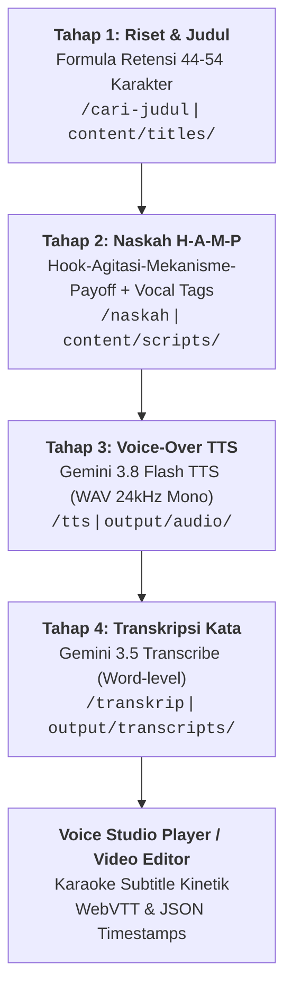

# 🎙️ AI Faceless Video Production Engine

[](https://www.python.org/downloads/)
[](https://fastapi.tiangolo.com)
[](https://react.dev/)
[](https://vitejs.dev/)
[](https://tailwindcss.com/)
[](https://github.com/google-gemini/generative-ai-python)
[](https://opensource.org/licenses/MIT)

**AI Faceless Video Production Engine** adalah platform end-to-end terstruktur untuk memproduksi video edukasi pendek vertikal (YouTube Shorts, TikTok, Instagram Reels) berbasis AI. Sistem ini mengintegrasikan **Google Gemini API** (`gemini-3.8-flash-tts` & `gemini-3.5-transcribe`), **FastAPI Backend**, serta **Mosaic Voice Studio Web UI**.

---

## 📑 Daftar Isi
- [Arsitektur Direktori Bersih](#-arsitektur-direktori-bersih)
- [Alur Produksi 4-Tahap](#-alur-produksi-4-tahap)
- [Fitur Utama](#-fitur-utama)
- [Voice Studio Web UI](#-voice-studio-web-ui)
- [Prasyarat Sistem](#-prasyarat-sistem)
- [Panduan Instalasi Cepat](#-panduan-instalasi-cepat)
- [Panduan Menjalankan Sistem](#-panduan-menjalankan-sistem)
- [Panduan CLI Scripting](#-panduan-cli-scripting)
- [Dokumentasi REST API](#-dokumentasi-rest-api)
- [Panduan Publish ke GitHub](#-panduan-publish-ke-github)
- [Lisensi & Kontribusi](#-lisensi--kontribusi)

---

## 🏗️ Arsitektur Direktori Bersih

Struktur direktori proyek telah dirapikan agar intuitif, modular, dan memiliki pembagian tanggung jawab (*separation of concerns*) yang jelas tanpa duplikasi:

```
voice-generator/
│
├── .agent/
│   └── skills/
│       └── faceless-creator/   # Skill modular untuk Antigravity / Gemini CLI Agent
│
├── content/                    # Sumber naskah & ide konten
│   ├── titles/                 # [Tahap 1] Bank riset ide & formula judul (.md)
│   └── scripts/                # [Tahap 2] Naskah narasi H-A-M-P dengan vocal tags (.txt / .md)
│
├── docs/                       # Dokumentasi resmi proyek
│   └── list-voice.md           # Panduan 30+ profil suara studio Gemini & 16 inline vocal tags
│
├── output/                     # Satu-satunya direktori hasil generasi AI
│   ├── audio/                  # [Tahap 3] File WAV voice-over resmi (24 kHz Mono)
│   └── transcripts/            # [Tahap 4] Subtitle WebVTT (.vtt) & JSON word-level timestamps
│
├── scripts/                    # CLI script mandiri berbasis Google GenAI SDK
│   ├── auto_tag_script.py      # Penginjeksi inline vocal tags otomatis ke teks
│   ├── generate_audio_gemini.py# Generator TTS Gemini 3.8 Flash
│   └── transcribe_words.py     # Transkripsi kata per kata Gemini 3.5 Transcribe
│
├── server/                     # Backend API (FastAPI + SSE + Uvicorn)
│   ├── routers/                # Endpoint modular: titles, scripts, tts, transcribe, pipeline, history
│   ├── services/               # Gemini Service SDK & pipeline execution engine
│   ├── config.py               # Konfigurasi environment & katalog suara studio
│   ├── schemas.py              # Skema validasi Pydantic
│   └── main.py                 # Inisialisasi FastAPI & middleware
│
├── ui/                         # Frontend Voice Studio (React 19 + TypeScript + Vite + TailwindCSS)
│   ├── public/                 # Aset statis web (favicon, icons)
│   ├── src/                    # Source code React (components, services, types)
│   ├── package.json            # Dependensi frontend
│   └── vite.config.ts          # Konfigurasi Vite & proxy backend
│
├── .env.example                # Template konfigurasi environment (aman di-commit)
├── .gitignore                  # SATU-SATUNYA file ignore untuk seluruh project
├── requirements.txt            # Dependensi Python backend
├── run_studio.py               # Runner satu perintah (FastAPI + Vite dev server)
├── test_e2e.py                 # Skrip pengujian integrasi E2E
└── README.md                   # SATU-SATUNYA dokumentasi utama project
```

> [!NOTE]
> **Penyederhanaan Arsitektur:**
> 1. **1 Gitignore Sahaja:** Semua aturan ignore (Python, Virtualenv, Vite, node_modules, build dist, audio binary) dipusatkan di root [`.gitignore`](file:///c:/Users/ruby/experimental/voice-generator/.gitignore).
> 2. **1 README Sahaja:** Hanya ada satu [`README.md`](file:///c:/Users/ruby/experimental/voice-generator/README.md) di root proyek.
> 3. **Output Terpusat:** Seluruh file audio WAV dan transkrip JSON/VTT disimpan di [`output/`](file:///c:/Users/ruby/experimental/voice-generator/output/) tanpa duplikasi ke folder mirror.
> 4. **Frontend Mandiri:** Seluruh kode antarmuka web berada rapi di dalam [`ui/`](file:///c:/Users/ruby/experimental/voice-generator/ui/).

---

## 🔄 Alur Produksi 4-Tahap



### 1. Riset & Judul (`content/titles/`)
Menghasilkan judul tajam sepanjang **44–54 karakter** dengan kata kunci utama di depan. Menggunakan 5 pilar retensi:
- **Numerical Specificity:** "5 Trik Rahasia Baterai HP Awet 48 Jam"
- **Contrarian/Negative:** "Jangan Pernah Cas HP 120W Semalaman!"
- **Curiosity Gap:** "Kenapa Chip 3nm Bikin HP Lebih Dingin?"
- **How Things Work:** "Cara Kerja Kamera Periskop 100x Zoom"
- **Urgency:** "Cek Pengaturan Ini Sebelum HP Kamu Kena Sadap!"

### 2. Naskah H-A-M-P & Vocal Tags (`content/scripts/`)
Naskah padat 45–60 detik (~120–145 kata) dengan 4 babak:
1. **Hook (0–3 detik):** Kontradiksi / angka mengejutkan pemecah lamunan scroll (tanpa basa-basi pembuka).
2. **Agitasi (4–15 detik):** Dampak nyata kerugian langsung penonton.
3. **Mekanisme (15–38 detik):** Penjelasan teknis sederhana dengan analogi nyata (*visual receipts*).
4. **Payoff / CTA (38s–selesai):** Solusi solutif instan + ajakan polling interaktif.
Dilengkapi inline vocal tags: `<short pause>`, `<long pause>`, `<breath>`, `<sigh>`, `<gasp>`, `<chuckle>`, `<pff>`, `<phew>`.

### 3. Voice-Over TTS (`output/audio/`)
- Menggunakan model `gemini-3.8-flash-tts` melalui Google GenAI SDK.
- Output berupa audio lossless WAV (24 kHz, 16-bit Mono) berkualitas broadcast.
- Didukung 30+ profil suara studio resmi (lihat [docs/list-voice.md](file:///c:/Users/ruby/experimental/voice-generator/docs/list-voice.md)).

### 4. Transkrip Kata per Kata (`output/transcripts/`)
- Menggunakan model `gemini-3.5-transcribe` dengan `timestamp_granularities: ["word"]`.
- Menghasilkan file JSON `{ text, startSec, endSec }` dan subtitle WebVTT presisi milidetik untuk animasi teks kinetik.

---

## 🎨 Voice Studio Web UI

Antarmuka web modern menyatukan seluruh proses produksi dalam satu dashboard interaktif:

- 🌌 **Visual Sky Shader WebGL:** Background visual dinamis responsif kanvas Three/WebGL.
- 🎛️ **Dual-Mode Workflow:** Mode "Full Pipeline" otomatis (dari ide sampai audio + subtitle) atau "TTS Generator" langsung.
- 🎤 **Katalog Suara Interaktif:** Pilihan 30+ suara dengan label karakter, gender, dan preview gaya bicara.
- 📝 **Composer Cerdas:** Toolbar penyisipan tag vokal satu klik ke naskah Anda.
- 🎵 **Karaoke Audio Player:** Pemutar audio terintegrasi dengan highlight kata tersinkronisasi realtime.
- 📡 **Live Stream Log:** Pemantau progress eksekusi secara streaming via Server-Sent Events (SSE).

---

## ⚙️ Prasyarat Sistem

Sebelum memulai, pastikan perangkat Anda telah terinstal:
- **Python:** Versi `3.10` atau lebih baru
- **Node.js:** Versi `18.0` atau lebih baru (disarankan Node 20 LTS) & npm
- **Google Gemini API Key:** Dapatkan secara gratis melalui [Google AI Studio](https://aistudio.google.com/)

---

## 🚀 Panduan Instalasi Cepat

### 1. Kloning Repository
```bash
git clone https://github.com/<username>/<repo-name>.git
cd voice-generator
```

### 2. Konfigurasi Environment
Salin file `.env.example` menjadi `.env` dan masukkan API Key Gemini Anda:
```bash
# Di Windows PowerShell:
Copy-Item .env.example .env

# Di Linux / macOS:
cp .env.example .env
```
Buka file `.env` dan isi kunci API Anda:
```env
GEMINI_API_KEY=AIzaSy...
```

### 3. Instalasi Dependensi Python
Disarankan menggunakan virtual environment:
```bash
# Membuat virtual environment
python -m venv .venv

# Aktivasi di Windows:
.venv\Scripts\activate

# Aktivasi di Linux / macOS:
source .venv/bin/activate

# Instal dependensi backend
pip install -r requirements.txt
```

### 4. Instalasi Dependensi Frontend UI
```bash
cd ui
npm install
cd ..
```

---

## 💻 Panduan Menjalankan Sistem

### Menjalankan Studio (Satu Perintah)
Cukup jalankan satu perintah orchestrator berikut di direktori root:
```bash
python run_studio.py
```

Skrip ini akan secara otomatis:
1. Memverifikasi kelengkapan dependensi Python dan Node.js.
2. Menjalankan server backend **FastAPI** di `http://127.0.0.1:8000`.
3. Menjalankan server frontend **Vite** di `http://127.0.0.1:5173`.
4. Membuka browser default langsung ke dashboard Voice Studio.

#### Opsi Eksekusi Tambahan:
```bash
# Jalankan tanpa otomatis membuka browser
python run_studio.py --no-browser

# Hanya jalankan backend API
python run_studio.py --backend-only

# Hanya jalankan frontend UI
python run_studio.py --frontend-only

# Tentukan custom port
python run_studio.py --backend-port 8080 --frontend-port 3000
```

---

## 🛠️ Panduan CLI Scripting

Setiap modul dapat dieksekusi secara terpisah melalui terminal:

### 1. Injeksi Tag Vokal Otomatis
```bash
# Preview hasil auto-tag ke terminal
python scripts/auto_tag_script.py content/scripts/naskah_ai.txt

# Simpan hasil auto-tag ke file baru
python scripts/auto_tag_script.py content/scripts/naskah_ai.txt content/scripts/naskah_ai_tagged.txt
```

### 2. Sintesis Voice-Over (TTS)
```bash
# Menggunakan file naskah (output otomatis ke output/audio/<nama-file>.wav)
python scripts/generate_audio_gemini.py content/scripts/naskah_ai.txt

# Menentukan file output dan profil suara tertentu (misal: Kore)
python scripts/generate_audio_gemini.py content/scripts/naskah_ai.txt output/audio/baterai.wav Kore

# Menggunakan teks langsung
python scripts/generate_audio_gemini.py "Jangan pernah cas HP semalaman! <sigh> Ini bahayanya." output/audio/warning.wav Fola
```

### 3. Transkripsi Kata per Kata (Word-Level Timing)
```bash
# Transkrip file audio spesifik
python scripts/transcribe_words.py output/audio/baterai.wav

# Otomatis mencari audio di folder output/audio/
python scripts/transcribe_words.py baterai.wav
```

### 4. Perintah Skill Antigravity / Gemini CLI
Jika menggunakan agen Antigravity, Anda dapat memanggil perintah slash langsung di ruang obrolan:
- `/cari-judul [topik/berita]` — Riset ide judul viral
- `/naskah [nomor/judul]` — Buat naskah H-A-M-P dengan vocal tags
- `/tts` — Generate audio voice-over dari naskah aktif
- `/transkrip` — Generate alignment kata per kata untuk subtitle

---

## 📡 Dokumentasi REST API

Backend FastAPI menyediakan API komprehensif di port `8000`. Dokumentasi interaktif Swagger UI tersedia di `http://127.0.0.1:8000/docs`.

| Method | Endpoint | Deskripsi |
|---|---|---|
| `GET` | `/api/health` | Status kesehatan server dan API key |
| `GET` | `/api/titles` | Ambil daftar ide judul dari `content/titles/` |
| `POST` | `/api/titles/generate` | Generate 5 variasi judul baru dari topik mentah |
| `GET` | `/api/scripts` | Ambil daftar naskah dari `content/scripts/` |
| `POST` | `/api/scripts/generate` | Generate naskah H-A-M-P baru berdasarkan judul |
| `POST` | `/api/scripts/auto-tag` | Tambahkan inline vocal tags otomatis ke teks |
| `GET` | `/api/tts/voices` | Daftar 30+ profil suara studio resmi |
| `GET` | `/api/tts/tags` | Daftar 16 official Gemini vocal tags |
| `POST` | `/api/tts/generate` | Generate audio WAV dari teks/naskah |
| `POST` | `/api/transcribe` | Transkrip file audio menjadi kata per kata |
| `POST` | `/api/pipeline/run` | Jalankan full pipeline 4 tahap secara asynchronous |
| `GET` | `/api/pipeline/stream/{job_id}` | SSE stream untuk progress realtime pipeline |
| `GET` | `/api/history` | Riwayat audio dan transkrip yang telah digenerate |
| `GET` | `/api/audio/{filename}` | Streaming file audio WAV output |
| `GET` | `/api/transcripts/{filename}`| Mengambil file JSON atau WebVTT transkrip |

---

## 📤 Panduan Publish ke GitHub

Ikuti langkah-langkah berikut untuk mempublikasikan proyek ini ke repositori GitHub pribadi atau organisasi Anda:

### 1. Inisialisasi Git Lokal
Pastikan Anda berada di direktori root `voice-generator`:
```bash
git init
```

### 2. Verifikasi File yang Diabaikan (.gitignore)
Periksa status file untuk memastikan file sensitif seperti `.env` dan direktori berat seperti `node_modules/` **tidak ikut ter-tracking**:
```bash
git status
```
> [!IMPORTANT]
> Pastikan file `.env` berisi API Key pribadi Anda **TIDAK** muncul di daftar `Changes to be committed`. Hanya `.env.example` yang boleh di-commit!

### 3. Stage & Commit File
```bash
git add .
git commit -m "feat: initial clean release AI Faceless Video Production Engine"
```

### 4. Hubungkan ke Remote GitHub & Push
Buat repositori baru di [GitHub](https://github.com/new) (kosongkan tanpa menambahkan README/license/gitignore default), lalu jalankan:
```bash
git branch -M main
git remote add origin https://github.com/<username>/<nama-repo>.git
git push -u origin main
```

---

## 📄 Lisensi & Kontribusi

Proyek ini dirilis di bawah lisensi **MIT License**.

Kontribusi, perbaikan bug, dan penambahan fitur baru selalu disambut dengan hangat! Silakan buat *Issue* atau kirimkan *Pull Request*.
